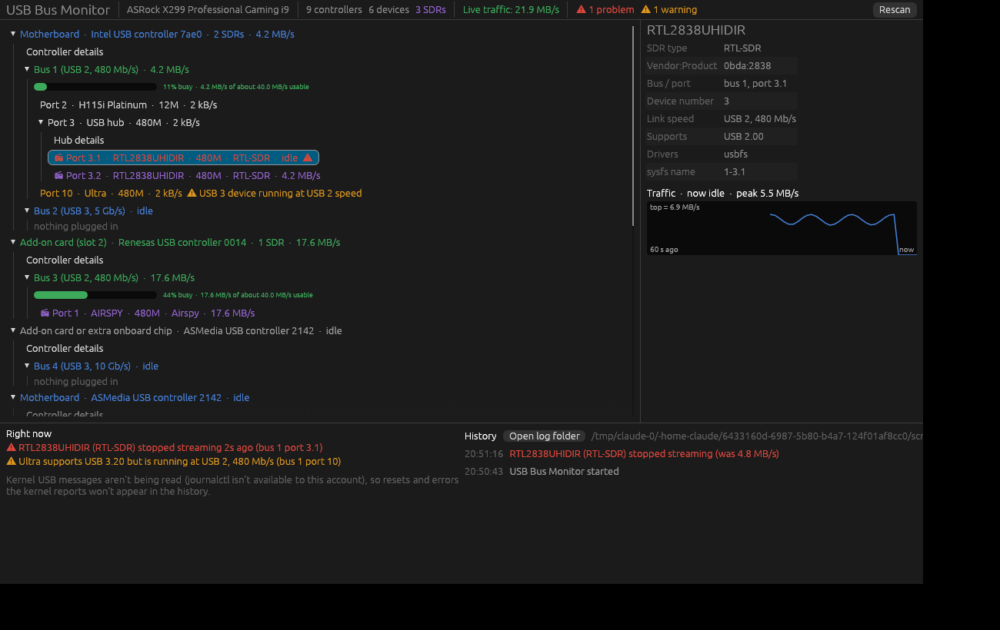

# USB Bus Monitor

A USB bus monitor that watches traffic and highlights errors and problems.



A desktop window that shows every USB controller in a Linux PC (motherboard and
add-on cards), the buses each one drives, and every hub and device plugged in,
with SDR receivers highlighted. Built for Ubuntu 26.04 on any 64-bit Intel/AMD PC.

The program reads the hardware fresh every time it runs (and every 2 seconds
while open), so the same copy works on any of your PCs.

## Install (once per PC)

Download `usb-monitor-bin` from the
[latest release](https://github.com/photounit/usb-bus-monitor/releases/latest), then in a Terminal in the folder it's in:

```
chmod +x usb-monitor-bin
./usb-monitor-bin --install
```

That adds **USB Bus Monitor** to the app menu with its own icon (no sudo
needed; everything goes in your home folder). Open it from the menu like any
other app, and right-click its dock icon and pick "Pin to Dash" to keep it
there. You can delete the downloaded file afterwards.

To update, download the new `usb-monitor-bin` and run the same two commands.
To remove it, run `~/.local/bin/usb-monitor --uninstall`.

You can also run it without installing: `./usb-monitor-bin`.

No sudo is needed to see the layout. To print the layout as text instead of
opening the window, run `./usb-monitor-bin --dump`.

For nicer device and controller names, install the ID database once:
`sudo apt install hwdata usbutils`.

## Turn on live traffic (one time per PC)

Live traffic uses Linux's built-in USB monitor, `usbmon`, which is off by
default. The first time you open the app it shows a yellow banner with a
**Set up live traffic…** button. Click it and enter your password. Or run this
from the folder with the files:

```
sh setup-usbmon.sh
```

Either way it loads usbmon now and at every boot and lets your desktop account
read it, so the app never needs sudo. Note that usbmon can see all USB
traffic, including keyboards, for users allowed to read it (your desktop login
and the `plugdev` group).

## Build it yourself

```
sudo apt install build-essential curl git
curl --proto '=https' --tlsv1.2 -sSf https://sh.rustup.rs | sh   # Rust 1.95 or newer
git clone https://github.com/photounit/usb-bus-monitor
cd usb-bus-monitor
cargo build --release
./target/release/usb-monitor
```

Use rustup rather than Ubuntu's `rustc` package, which may be older than the
GUI library needs. Run `cargo test` to check the build against a simulated
system.

## Reading the window

- **Controllers** are the top level. "Motherboard" means built into the board,
  including extra USB chips the board maker added. "Add-on card (slot N)" is a
  card in PCIe slot N, and "Add-on card 17:00 (4 controllers)" is one card with
  several controllers on it. "Add-on card or extra onboard chip" means Linux
  can't tell. Click "Controller details" to give any controller your own name;
  names are saved in `~/.config/usb-monitor/names.txt`.
- **Buses**: most USB 3 controllers show two buses, a USB 2 one and a USB 3 one,
  that share the same physical ports. RTL-SDRs and most SDRs are USB 2 devices,
  so they appear on the USB 2 bus.
- 📻 marks an SDR. The count beside each controller shows how many SDRs share
  it, since they all share that controller's bandwidth.
- **Traffic**: each controller, bus and device shows its current rate. Each
  bus with something plugged in gets a bar showing how full it is against what
  that bus can realistically carry (about 40 MB/s for USB 2, 400 MB/s for
  5 Gb/s USB 3). Green is under 50%, amber 50–80%, red over 80%.
- ⚠ marks a USB 3 device stuck at USB 2 speed, or a device that has had
  transfer errors since the app started.
- Click anything to see its details on the right: a 60-second traffic graph
  for devices, a graph per bus for controllers, and a breakdown of any errors.

## Issues panel

The panel along the bottom has two halves.

**Right now** lists anything wrong at this moment, worst first:

- a bus, hub uplink or a card's PCIe link over 80% busy for 3 seconds or more
- an SDR that has stopped streaming (shown for a minute) or is running well
  below its own recent rate
- a device with transfer errors in the last minute
- a USB 3 device stuck at USB 2 speed

The same problems also turn the matching controller or device red or amber in
the tree, and the top bar counts them.

**History** keeps a timestamped list of everything that happened since the app
started: devices connecting, disconnecting, or dropping off and reconnecting,
SDR streams stopping, dropping and recovering, busy links, bursts of transfer
errors, and USB trouble reported by the kernel (resets, enumeration failures,
over-current, xHCI and UAS errors, and disk I/O errors from USB drives).

History is also saved to `~/.local/state/usb-monitor/events.log`, so you can
leave the app running and read what happened later. "Open log folder" opens it.

Kernel messages are read with `journalctl`, which Ubuntu allows for accounts in
the `adm` group (the first account on a desktop install is). If yours isn't,
the panel says so, and `sudo usermod -aG adm $USER` followed by logging out and
back in fixes it.

## License

GNU General Public License v3.0. See [LICENSE](LICENSE).
